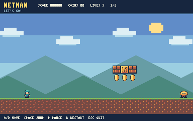

# Learn.DosGame

Active development lives in [NetMan](NetMan/README.md), a .NET 10 pixel-art platformer with a native Windows game window and editable text levels. [NetMan-0.1](NetMan-0.1/README.md) preserves the original console version.



From this repository folder, run:

```powershell
dotnet run --project .\NetMan\NetBro.csproj
```

See the game README for controls, editable text levels, and development checks.
