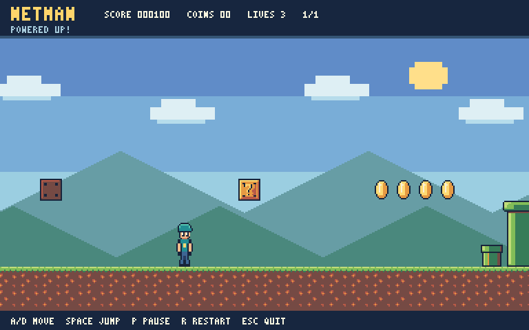
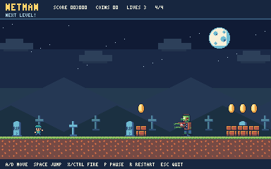

# NetMan Game

This aint ya mamma's side scroller. NetMan is a .NET pixel-art platformer with a native game window and editable Sprites, Text levels, and really bad uncle quotes. Written 100% in C# and not forgiving like modern Mario games.

> In the words of Ivan Drago,\
> &nbsp; &nbsp;"_If he dies, he dies._"






From this repository folder, run:

```powershell
dotnet run --project .\NetMan\NetMan.csproj
```

See the game README for controls, editable text levels, and development checks.

## Build a release

From the repository root, run:

```powershell
.\build.ps1
```

Project and output paths resolve relative to the script, so it also works when invoked by absolute path from another working directory.

To publish and launch the game, double-click `build-exec.bat` or run:

```powershell
.\build-exec.bat
```

This runs the same Release build, tests, Native AOT publish, and ZIP packaging, then opens the newly published game. If any step fails, the game is not launched. Build options are forwarded, for example `.\build-exec.bat -SkipTests`. The PowerShell equivalent is `.\build.ps1 -Run`.

## Hubmle Beginnings

NetMan started out as a side-scrolling DOS pixle art game. The orginal code can be found in the Legacy folder [NetMan-0.1](Legacy/NetMan-0.1/README.md) which preserves the original console version.

## Developer Notes

* Active development lives in [NetMan](NetMan/README.md)
* More [developer notes](Docs/dev-notes.md)
